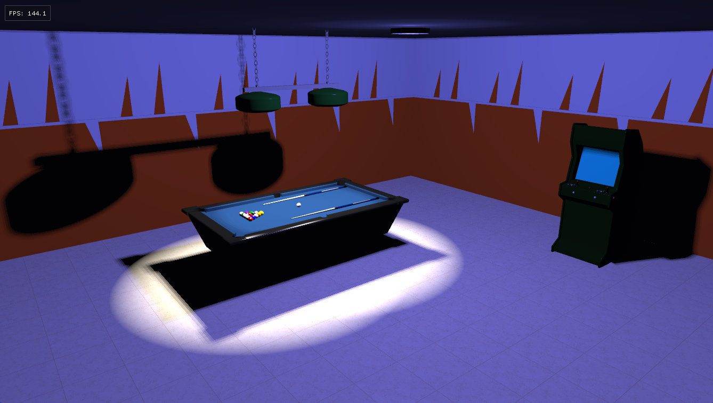
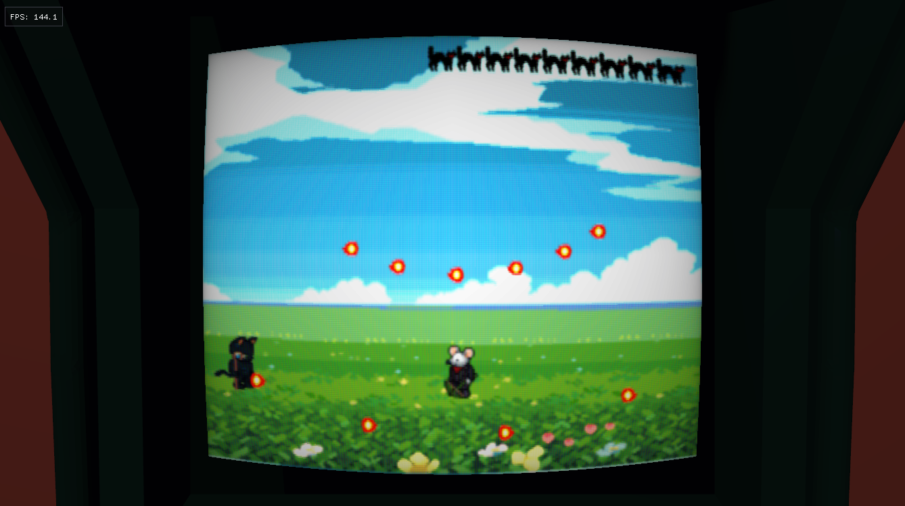

# RoyalGreen

[](https://github.com/ppvGH/RoyalGreen/actions/workflows/sac4ap.yml?query=branch%3Asac4ap)

RoyalGreen is a C++17/OpenGL 3.3 desktop application: explore a retro arcade room, select its cabinet, and play a small 2D combat game rendered on the cabinet screen. The room includes imported Blender models, materials, lighting, and shadows.

**[English documentation](docs/index.md)** provides installation instructions, a playable tutorial, architecture and API references, and testing guidance. This is an educational project with known limitations; see [validation](docs/validation.md) for recorded results.

The `sac4ap` branch adapts this project for the Software and Computing for Applied Physics exam. It preserves all **263 original commits** and changes existing production files only through comments; the original application CMake files and assets remain unchanged. See [exam readiness](docs/exam-readiness.md) for assessment evidence and [the improvement report](docs/improvement-report.md) for proposed changes.

## Quickstart on Windows

Use Windows 10/11 x64, Visual Studio 2022 with the v143 C++ tools and a Windows SDK, Git, and **CMake 3.24 or newer within the 3.x series**. A graphics driver supporting OpenGL 3.3 Core is required. Initial configuration downloads dependencies.

Run these commands in PowerShell:

```powershell
git clone --branch sac4ap https://github.com/ppvGH/RoyalGreen.git
Set-Location RoyalGreen
cmake --version
cmake -S . -B build/app -G "Visual Studio 17 2022" -A x64
cmake --build build/app --config Debug --target royalgreen --parallel
.\build\app\Debug\royalgreen.exe
```

For Release, build with `--config Release` and run `.\build\app\Release\royalgreen.exe`. See [installation and troubleshooting](docs/installation.md), including tool setup and running on another machine.

A self-built executable uses resource paths embedded from **your clone folder**. Keep that folder and its `res/` directory in place. The original install target does not produce a standalone package.

## First play

Use **W/A/S/D** and the mouse to explore. **F** toggles fixed camera height, **T** toggles the aiming cross, and **H** toggles help. Aim at the arcade cabinet, left-click, and choose **Play**.

Inside the game: **A/D** move, **W** jumps, **S** shoots, **M** opens the menu, and **H** toggles help. The menu offers **Return to game**, **Reset game**, and **Exit game**. **Esc** or the window close button closes the application. Follow the [tutorial](docs/tutorial.md) for a complete example.

## Checks

The separate test project leaves the original application CMake project intact. With Python 3.10+ installed:

```powershell
python scripts/verify_assets.py
python scripts/check_source_unchanged.py
cmake -S tests -B build/tests -G "Visual Studio 17 2022" -A x64
cmake --build build/tests --config Debug --parallel
ctest --test-dir build/tests -C Debug --output-on-failure
```

See [automated testing](docs/testing.md) and the [manual checklist](docs/manual-testing.md) for coverage, limitations, and result records.

## Preview

Repository screenshots illustrate the project; they are not evidence of a new test run.



